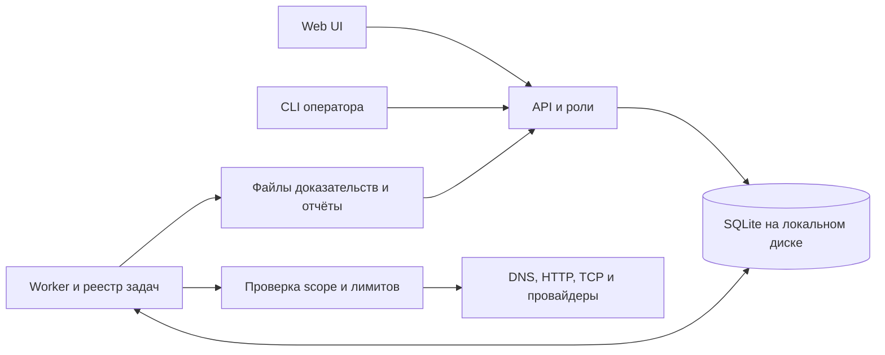

# LasTest без Go

Исходный проект архитектуры переписывания LasTest. Актуальное описание Rust-приложения находится в [README.md](README.md). Исходная точка для сравнения — [LasTest 1.x](https://github.com/lasnet/LasTest/tree/v1-legacy), коммит `2a3a845`.

## Ошибка на чистом хосте

По приложенному журналу Git успешно клонировал репозиторий со второй попытки, а Compose начал собирать образ. Сборка остановилась в `go-tools 3/3`, на первом `go install` из [Dockerfile](https://github.com/lasnet/LasTest/blob/v1-legacy/Dockerfile#L15-L30). В журнале загрузился `subfinder/v2 v2.17.0`, затем компилятор получил `no space left on device` при записи в `$WORK` и создании каталогов в `/tmp/go-build…`. Ошибка произошла на этапе сборки образа до старта приложения.

Журнал подтверждает ошибку выделения места в среде сборки. Его недостаточно, чтобы отличить нехватку блоков или inode от квоты или лимита диска Docker. Для проверки текущего хоста достаточно начать с `docker info`, `docker system df -v`, `df -h` и `df -i` на машине, где работает Docker daemon, с учётом фактических разделов хранилища Docker. Учёт данных образов, слоёв и томов описан в [документации Docker](https://docs.docker.com/engine/storage/drivers/).

Python реализует приложение, а Go используется в семи внешних инструментах, собираемых в Docker, и в доставляемом через APT `ffuf`. `amass` тоже есть в образе, хотя в текущих путях CLI и web вызова не найдено. Объём временных файлов растёт на этапе скачивания и компиляции. `GOPATH` и `GOCACHE` удаляются в конце успешного шага, поэтому эта очистка не уменьшает требуемый пик места. `@latest`, rolling-образ и APT добавляют независимый источник изменений между двумя сборками. [Dockerfile](https://github.com/lasnet/LasTest/blob/v1-legacy/Dockerfile) · [Семантика `go install …@latest`](https://go.dev/doc/go-get-install-deprecation)

Старый журнал содержит `rm -r LasTest/` перед повторным клонированием. В Compose данные монтируются из `./projects`, `./data` и `./logs`, а Git их игнорирует. Если эти каталоги хранились внутри удалённой копии, новое клонирование их не восстановит. Для нового развёртывания данные должны иметь отдельный жизненный цикл. [Compose](https://github.com/lasnet/LasTest/blob/v1-legacy/docker-compose.yml) · [Игнорируемые пути](.gitignore)

## Архитектурное решение

Переписать ядро на Rust. Поставлять один бинарник `lastest` с режимами `serve`, `worker` и CLI-командами администрирования, импорта и запуска задач. Сохранить один хост, SQLite и статический интерфейс на HTML/CSS/JS. Web и CLI вызывают одни и те же команды приложения. CLI оператора работает через API, а локальное начальное администрирование и импорт доступны владельцу хоста через отдельные команды с доступом к каталогу данных.

Rust здесь даёт удобный формат поставки и позволяет разделить контроль ресурсов и сетевой ввод-вывод между задачами, сохраняя типизированную модель целей и артефактов. Язык сам по себе не решает проблему невоспроизводимой сборки и не гарантирует ускорение запросов, ограниченных сетью или квотой провайдера. Переписать только слой управления было бы недостаточно для отказа от Go, поскольку старые модули выполняют внешние бинарники. Выбор Rust обоснован форматом поставки и предполагает замеры на этапе прототипа.

| Компонент | Предлагаемая реализация |
| --- | --- |
| Web и CLI | Axum, Tokio и Clap. Встроенные статические файлы, единые API-схемы, роли и состояния задач. |
| Хранилище | SQLite через `rusqlite` с поставляемой SQLite. Короткие транзакции и ограниченный пул для блокирующих операций. |
| Сетевые задачи | Hickory для DNS, `reqwest` с Rustls для HTTP и провайдеров, Tokio TCP для портов. Один общий слой проверки целей перед соединением. |
| Доставка | Готовый OCI-образ с бинарником и CA-сертификатами. Два процесса из одного образа. Отдельный адаптер Nmap для расширенных профилей при необходимости. |

[Axum](https://docs.rs/axum) · [Hickory DNS](https://hickory-dns.org/) · [Настройки HTTP-клиента](https://docs.rs/reqwest/latest/reqwest/struct.ClientBuilder.html) · [Rusqlite](https://docs.rs/rusqlite/latest/rusqlite/)

`serve` отвечает за проекты, редактор scope, каталог задач, очередь, dashboard, сессии и аудит. `worker` читает очередь, выполняет ограниченные по ресурсам задачи и сохраняет результаты. UI запрашивает состояние и историю через API. Реестр связывает тип задачи с валидируемыми параметрами, правилами выбора целей и форматом результата. Произвольная команда или список аргументов внешней программы в этот интерфейс не входят.

Предлагаемый базовый путь API `/api`. Первые операции — проекты, чтение и обновление scope, каталог задач, постановка с ответом `202` и ID, получение статуса, отмена, dashboard и экспорт. Примеры имен задач — `dns.records`, `http.probe`, `subdomains.discover`, `web.checks`. Имена описывают поддерживаемую функцию. Старые идентификаторы `subfinder`, `httpx-root` и `nuclei` сохраняются в импортированной истории, чтобы исторические результаты можно было отличить от нового покрытия. Ответ задачи включает статус, версию входных параметров и scope, счётчики обработанных и пропущенных целей и ссылки на результаты.

## Что переносить из существующей логики

| Сценарий | Текущая реализация | Реализация без Go |
| --- | --- | --- |
| Проекты, scope, Web UI, авторизация | `core/project.py`, `app/services/projects.py`, `app/services/auth.py`, `app/static/` | Проекты и версии scope в SQLite. Сохранить явный выбор проекта, роли `viewer`, `analyst`, `admin`, аудит, dashboard по реальным результатам и запуск задач из CLI и web. |
| Поиск поддоменов и DNS | `subfinder`, `findomain`, `dnsmap`, `hakrevdns`, `dnspython`. PTR и пассивный reverse IP через Shodan InternetDB и Censys. | Подключаемые пассивные источники с указанием происхождения данных. DNS `A`, `AAAA`, `CNAME`, `MX`, `NS`, `TXT` и `PTR` внутри worker. Словарный поиск с отбрасыванием wildcard-ответов. Подключение каждого провайдера зависит от его доступности и квот. |
| HTTP на корнях и полных URL | ProjectDiscovery `httpx` в CLI, web и отчётах. | Один HTTP-пробер с профилями для корней и URL. Сохранять статус, заголовок, сервер, TLS и признаки технологий с указанием источника. Вынести технологические группы в отдельный этап поверх нормализованных результатов. |
| Поиск URL и обход сайта | `gau` и `waybackurls`, затем `ffuf` и `katana`, в том числе через CLI `All in one`. | Прямые клиенты индексов Wayback и Common Crawl, ограниченный HTML-обход, словарный поиск путей с проверкой soft 404. Сохранить сырое значение и отдельный ключ дедупликации. Браузерный JS-обход и полный охват источников `gau` требуют отдельных этапов. [Wayback CDX](https://github.com/internetarchive/wayback/blob/master/wayback-cdx-server/README.md) · [Common Crawl Index](https://index.commoncrawl.org/) · [Режимы Katana](https://docs.projectdiscovery.io/opensource/katana/overview) |
| Сетевой инвентарь | Nmap для сервисов, ОС и web-профилей. Отдельный TCP-режим через SOCKS5 включает снимок domain → IP, контроль качества прокси и раздельные результаты кандидатов и подтверждённых портов. | Нативный TCP connect для явного списка адресов и портов. Позже добавить разрешённые SOCKS5-профили с проверкой на контролируемой цели и повторным подтверждением результатов. Определение ОС, расширенные сигнатуры сервисов и NSE оставить отдельному Nmap-адаптеру, который принимает только заданные администратором профили и возвращает XML. До поставки адаптера проверить условия распространения Nmap. [Формат XML Nmap](https://nmap.org/book/output-formats-xml-output.html) · [Условия Nmap](https://nmap.org/book/man-legal.html) |
| Web findings | Nuclei в CLI и web, JSON-результаты для dashboard. | Сохранить импорт исторических findings. Для новых проверок реализовать небольшой версионированный каталог проверок HTTP/TLS с идентификаторами, severity, доказательствами и положительными и отрицательными фикстурами. Начать с правил, где результат можно подтвердить ответом сервера, и явно описывать покрытие каждого правила. Полный язык шаблонов, протоколы, headless и тысячи правил Nuclei требуют отдельного решения о покрытии. [Модель шаблонов Nuclei](https://docs.projectdiscovery.io/templates/introduction) |
| Доказательства и отчёты | Сводки DNS/HTTP/IP/порты в CLI-отчёте о поддоменах. Есть JSON и CSV. | Сводка проекта в web и экспорт JSON/CSV по одному снимку данных. Хранить происхождение, время наблюдения и ссылку на доказательство. Для портов показывать реальные наблюдения TCP, отдельно от порта, указанного у HTTP-сервиса. |

OSINT в текущем меню — заглушка, phishing отключён, а файлы web-обвязок `sqlmap` и `whatweb` пусты. Их можно исключить из объёма переноса работающих сценариев. Имеющиеся вызовы Shodan и Censys относятся к recon. [Меню OSINT](https://github.com/lasnet/LasTest/blob/v1-legacy/modules/osint/menu.py) · [Меню phishing](https://github.com/lasnet/LasTest/blob/v1-legacy/modules/phishing/menu.py) · [Меню Web](https://github.com/lasnet/LasTest/blob/v1-legacy/modules/web/menu.py)

Основной процесс оператора после переноса — выбрать проект → задать scope → обнаружить поддомены → получить DNS и HTTP-наблюдения → собрать URL → проверить выбранные сервисы → выгрузить отчёт. Каждый шаг доступен отдельно. Существующий `All in one` переносится как набор явно связанных задач, где следующий шаг использует результаты конкретного запуска и видит частичные ошибки источников.

## Модель данных и проверка целей

- `projects` и `scope_revisions` хранят метаданные и неизменяемые версии разрешённых целей. Правила выражают точный хост, домен с поддоменами, IP либо CIDR. Исключение имеет приоритет над разрешением. Применять канонизацию IDNA, IPv4/IPv6 и проверку границы DNS-метки.
- `assets` хранит нормализованные домены, IP, URL и сервисы. `observations` хранит источник, время, тип наблюдения и ссылку на попытку задачи. Найденный актив сохраняется как наблюдение. Разрешение на активную проверку вычисляется отдельно из scope. Для URL сохранять исходный адрес и ключ дедупликации, чтобы эвристика удаления параметров не меняла фактический запрос.
- Проверять цели при постановке, а в worker — по снимку задания и действующему scope непосредственно перед сетевой операцией. Новая версия scope может сузить ранее разрешённый запуск. Расширение действует для новых заданий. Отдельно проверять переходы HTTP и итоговые адреса после DNS. TCP-профили работают по явно разрешённым IP или CIDR. Для HTTP с разрешённым именем соединение привязывается к проверенному IP с сохранением Host и SNI. Явно разрешённые внутренние диапазоны поддерживаются через настройки развёртывания. Доступ к инфраструктуре хоста и адресам метаданных блокируется на сетевом уровне и в проверке целей.
- PTR, ссылки из HTML, CNAME и результаты архивов могут вести за границу проекта. Сохраняй их как наблюдения с причиной пропуска. Если разрешён SOCKS5, передавай выбранный IP, чтобы прокси не разрешал имя повторно. Провайдеры пассивных данных используют фиксированные адреса и отдельные клиенты с таймаутами. Ключи хранятся в настройках worker и исключаются из журналов.
- Сессии для web — отзываемые случайные токены с серверным хранением хэша и cookie `HttpOnly`, `Secure`, `SameSite` через HTTPS. Изменяющие запросы из браузера проверяют источник запроса для защиты от CSRF. Для CLI — Bearer-токен с ограниченным сроком. Сохранить иерархию ролей и аудит действий. Новые пароли хэшировать Argon2id через готовую библиотеку. Модель глобальных ролей сохраняется для команды на одном хосте. Изоляция проектов между независимыми командами потребует отдельной модели доступа.

## Очередь и сохранение результатов

- В SQLite хранить `jobs`, `job_attempts`, `artifacts`, `findings` и `audit_events`. Для очереди использовать WAL на локальном диске и атомарный захват задачи короткой транзакцией. Запись попытки содержит ID worker, срок владения и heartbeat. Завершение проверяет ID текущей попытки, чтобы просроченный worker не мог заменить свежие результаты. Одновременно выполняется ограниченное число задач, а внутри каждой действуют лимиты запросов, подключений, размера ответа, времени и диска. [SQLite WAL](https://sqlite.org/wal.html) · [Остановка процессов Tokio](https://tokio.rs/tokio/topics/shutdown)
- Статусы `queued`, `running`, `succeeded`, `partial`, `failed`, `cancelled`, `interrupted`. Отмена снимает задачу из очереди или останавливает активную попытку. После сбоя worker повторяет безопасные чтения с ограничением числа попыток и задержкой, активные проверки с потенциальным побочным эффектом помечает `interrupted` для явного перезапуска. Идемпотентный ключ запроса защищает от повторной отправки из интерфейса, но не гарантирует однократное исполнение сетевой операции при сбое.
- Писать большие артефакты во временный каталог попытки на том же томе. После записи синхронизировать файл и каталог при публикации, затем фиксировать метаданные, наблюдения и финальный статус одной транзакцией. Файлы доступны через API только после фиксации индекса. После сбоя сверять файлы с SQLite и удалять только подтверждённо осиротевшие файлы завершённых или истёкших попыток. Dashboard использует нормализованные записи в SQLite и различает пустой результат, частичный прогон и отсутствие данных.

## Сборка и установка

1. Собирать релизы в CI под Linux. Поддержать `amd64` первым, затем публиковать единый `amd64`/`arm64` образ после проверки обеих архитектур. Закрепить Rust toolchain, `Cargo.lock`, базовый слой по digest и версии наборов проверок. Использовать `cargo build --release --locked`, публиковать контрольные суммы и сохранять манифест релиза. Многоэтапная сборка оставляет компилятор и кэш в CI. [Cargo](https://doc.rust-lang.org/cargo/commands/cargo-build.html) · [Многоэтапная сборка](https://docs.docker.com/get-started/docker-concepts/building-images/multi-stage-builds/) · [Мультиплатформенные образы](https://docs.docker.com/build/building/multi-platform/)
2. Целевой Compose ссылается на готовый образ по digest. Команда установки после публикации релиза — `docker compose pull` и `docker compose up -d --no-build`. Базовый образ содержит бинарник, сертификаты и необходимые системные файлы. Запуск происходит от непривилегированного пользователя. Устанавливаемые отдельно адаптеры имеют собственные закреплённые версии и показывают доступность в каталоге задач. [Digest образа](https://docs.docker.com/dhi/explore/security-concepts/digests/) · [Compose up](https://docs.docker.com/reference/cli/docker/compose/up/)
3. Держать SQLite и артефакты на постоянном локальном томе вне checkout. Резервная копия включает согласованный снимок SQLite и соответствующие ему файлы артефактов. Проще всего делать её с остановленной записью новых результатов. Базу копировать через SQLite Backup API, затем проверять восстановление в отдельный том. Перед запуском показывать свободное место и доступность тома, отдельно ограничить рост логов и доказательств. [SQLite Backup API](https://sqlite.org/backup.html)
4. Релиз проверять на чистом Linux без toolchain и build cache. Замерять сжатый размер образа, пик занятого диска при pull и старте, время до готовности API, память в простое и пропускную способность DNS/HTTP на одинаковых фикстурах. Начальные ориентиры для обсуждения — до 100 МиБ сжатого базового образа и до 120 МиБ суммарной памяти API и worker в простое. Ускорение подтверждать сравнением, включая время ожидания сети и ошибки по таймауту.

## Миграция с LasTest 1.x

1. Взять копию `projects/`, старой SQLite и нужных файлов журналов. Импортёр сначала выполняет пробный проход, показывает найденные проекты, ошибки, конфликты имён и количество записей. Исходные файлы читает в режиме импорта и сохраняет рядом отчёт. Повторный запуск на одинаковом входе не создаёт дубликаты.
2. Читать `config.yaml`, `recon/subdomains/subdomains.json`, DNS и HTTP JSON, `recon/urls/`, сетевые отчёты и `web/nuclei/findings.json`. Сохранять оригиналы и версию формата импорта. Строки scope из старого CLI могут содержать автоматические находки, поэтому переносить их как предложенные правила для подтверждения. До подтверждения проект доступен в dashboard в режиме просмотра.
3. Перенести завершённую историю и аудит как архив с исходными идентификаторами. `queued`/`running` из старой SQLite импортировать как архивные записи, чтобы новый worker не запустил их автоматически. Пользователей и роли можно импортировать с принудительной установкой нового пароля. Старые JWT, сессии, ключи провайдеров и абсолютные пути к логам не использовать в новом экземпляре.
4. Проверить на копии одного старого проекта результаты DNS, живые хосты, находки и отчёт. Затем переключить UI и CLI на новый экземпляр, сохранив снимок исходных данных и предыдущий digest для отката. Все записи после переключения идут в новую базу. При откате сохранять её отдельно, чтобы не потерять новые результаты.

## Порядок реализации

| Этап | Результат | Проверка готовности |
| --- | --- | --- |
| 1. Сквозной прототип | Rust-бинарник, CI-образ, проект и scope, `serve` и `worker`, минимальные DNS/HTTP-задачи, тестовый dashboard. | Чистый Linux-хост скачивает готовый образ, ставит работу в очередь и отображает реальный результат на локальном стенде. Проверить отмену, рестарт worker и запрет редиректа за пределы scope. Получить первые замеры размера, памяти и времени старта. |
| 2. Рабочая замена базового web-сценария | Авторизация и роли, аудит, один пассивный источник, HTTP-профили, первые проверенные web-правила, импорт старых данных, JSON/CSV. | Пройти цепочку проект → subdomains → DNS → HTTP → findings → отчёт. Сопоставить импорт с фикстурами существующей версии. Повторный импорт и рестарт не создают дублей. Утвердить перечень правил, который будет доступен вместо Nuclei в первом релизе. |
| 3. Перенос работающих CLI-сценариев | URL-архивы, HTML crawler, словари, tech routing, TCP connect, PTR и reverse IP, прокси-профили, Nmap-адаптер при подтверждённой потребности. | Пройти исходные работающие сценарии CLI на локальных стендах. Явно перечислить поддерживаемые скан-профили, источники и возможности старых инструментов, отложенные за пределы релиза. |

Первый этап стоит начинать с цепочки «готовый образ → проект → задача DNS/HTTP → результат». Она проверит весь новый способ установки и выполнения задач до трудоёмкого переноса Nuclei, URL discovery и расширенного сетевого сканирования.
